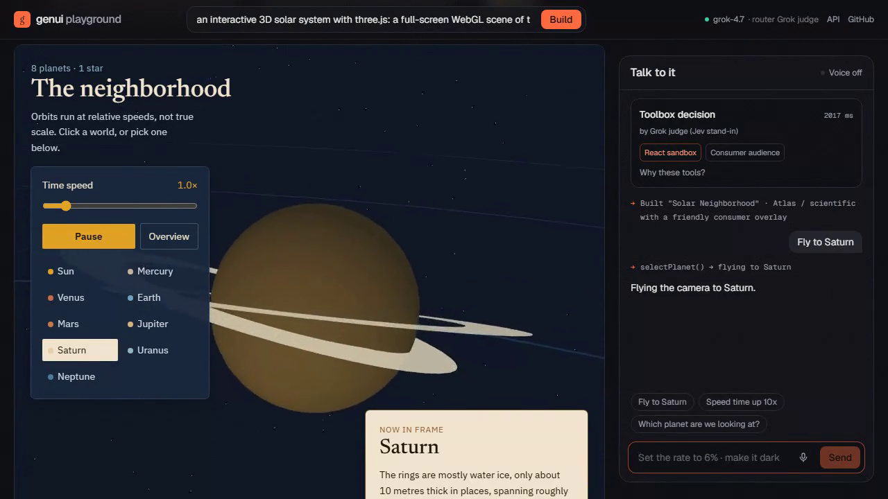
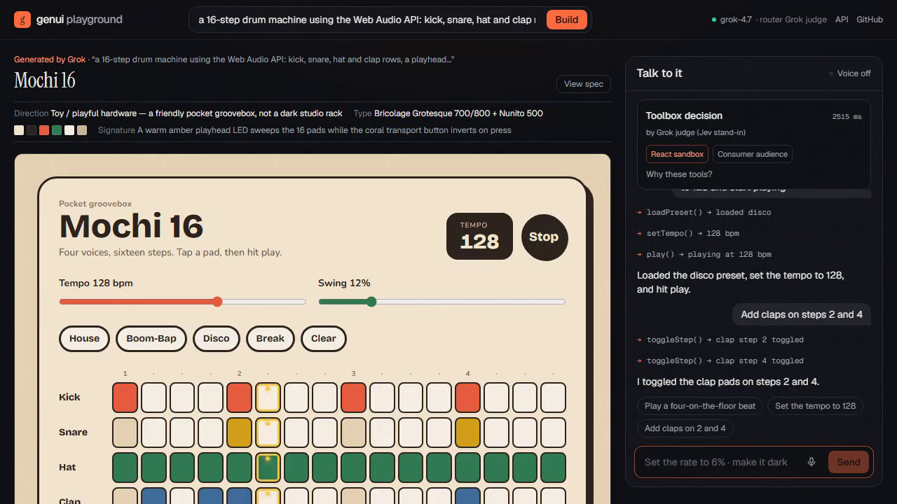
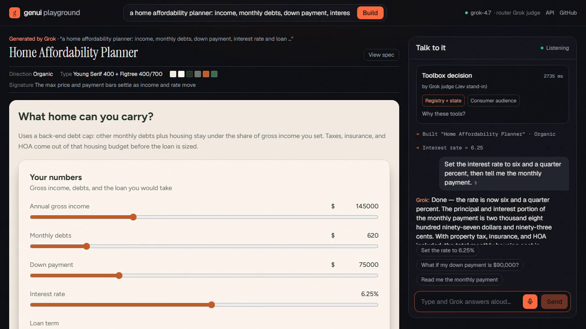
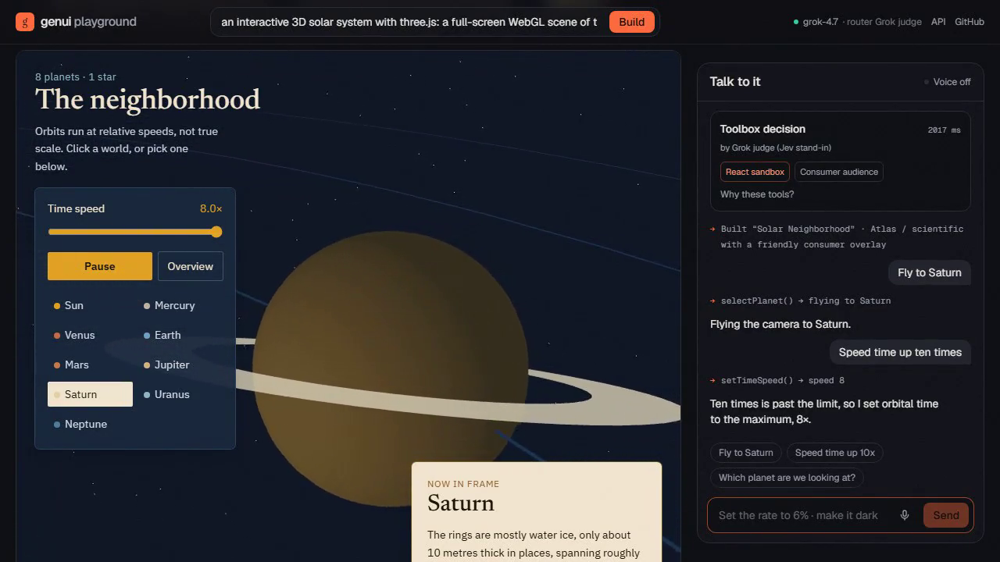
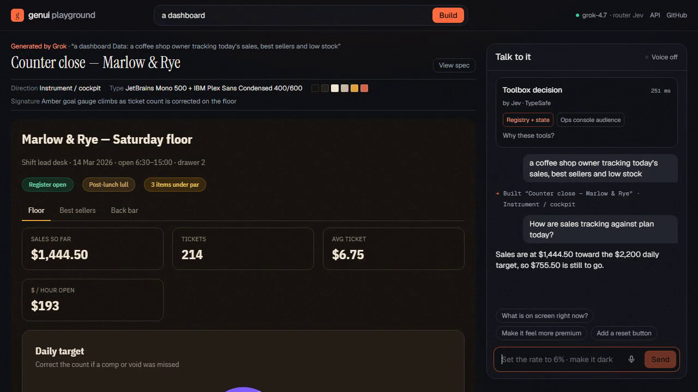

# GenUI Playground

[](https://github.com/jmurray10/generative-ai-ui/actions/workflows/ci.yml)
[](LICENSE)
[](#run-it)
[](#run-it)
[](https://docs.x.ai/)
[](#jev-picks-the-tools)

**Describe an interface. Then talk to it.** Type a sentence and a working,
interactive UI builds itself. Then chat with it or speak to it, and an agent
**operates** the UI for you (moves the slider, presses play, flies to Saturn)
instead of regenerating it.

> **This is a demo of *how* generative UI can be done.** Nothing is hard-coded:
> the gallery is just example *prompts*, and every UI is generated live from a
> toolbox. Generation needs a model key; without one the app loads and says so.



## What's in the loop

```
 prompt ──▶ /api/decide ──▶ Jev: route · ask one question · hold
               │
               ▼ route (lane, pieces, style family)
          /api/stream ──▶ Grok writes a design brief, then the UISpec, node by node
               │
               ▼
        live UI  ◀──── acts ──── /api/chat   (typed)
          ▲                      /voice      (Grok speech-to-speech)
          └── read: screen text + controls ──┘
```

1. **Route.** [Jev](#jev-picks-the-tools) reads the prompt and decides *how* to build it:
   which lane, which structural pieces it needs (table, drawer, stepper…), whether to
   ask you one question first, or whether to hold it (prompt injection,
   contradictions).
2. **Design & build.** Grok commits to a **design brief** before writing any UI: one
   of 13 named directions, a font pair, a palette, one signature moment. Then it
   streams the UI in. The brief is shown above every result.
3. **Operate.** Chat and voice share one control surface. Registry UIs expose every
   input and button automatically (`set:rate`, `press:reset`); sandboxed apps expose
   named actions with `window.genui.expose({...})` (`call:play`, `call:flyTo`), which
   run inside their iframe. The agent rebuilds only when you ask for a design or
   structural change.

## Demos

Unedited screen recordings of live runs against the real APIs: Jev's router picks
the tools, `grok-4.7` generates every interface, and voice is Grok's realtime
speech-to-speech (`grok-voice-latest`). The generation wait is sped up 8×;
everything after it plays in real time. Click a still to play the clip.

<table>
<tr>
<td width="50%"><a href="docs/media/drum-machine-chat.mp4"></a><br><sub><b>Chat operates the app</b>: one sentence becomes the drum machine's own actions (preset, tempo, play), then pads toggle on request.</sub></td>
<td width="50%"><a href="docs/media/voice-affordability.mp4"></a><br><sub><b>Voice, with sound</b>: a spoken request sets the rate on a registry UI (no rebuild), then Grok reads the new monthly payment aloud.</sub></td>
</tr>
<tr>
<td><a href="docs/media/solar-system-chat.mp4"></a><br><sub><b>3D, by conversation</b>: a three.js solar system; “fly to Saturn” and “speed time up” call the scene's exposed actions.</sub></td>
<td><a href="docs/media/jev-asks-first.mp4"></a><br><sub><b>Jev asks first</b>: “a dashboard” is too vague, so the router asks who it's for, then routes and builds from the answer.</sub></td>
</tr>
</table>

In the voice clip the question is a pre-recorded line in xAI's `leo` voice, fed to
the browser as its microphone; Grok answers in the app's `eve` voice. The
conversation panel shows both transcripts.

## The three lanes

The model picks per node from a toolbox (Jev can pin the lane):

- **Registry + state** (`src/client/engine/components.tsx`): ~28 audited React
  components. The model only fills props. Values live in one reactive state map;
  `bind` expressions run in a safe parser (`expr-eval-fork`, no `eval`). A spec can
  carry a `theme` (palette + Google Font) that passes a deterministic WCAG contrast
  check. Every input and button is operable by chat and voice for free.
- **JS sandbox** (`CustomWidget`): vanilla HTML/JS in a `sandbox="allow-scripts"`
  iframe with a network-blocking CSP: canvas visuals, games.
- **React sandbox** (`ReactArtifact`): freeform React + Tailwind, transpiled in a
  sandboxed iframe, with real npm imports (recharts, three, framer-motion, dnd-kit,
  gsap…) and `fetch()` to a short allow-list of public APIs.

## Jev picks the tools

[Jev](https://typesafe.ai) (TypeSafe) is a typed decision model: it answers a fixed
set of typed questions about the prompt (which lane fits, does it need a table or a
drawer, is anything missing, is it an injection attempt) with calibrated
probabilities. **The policy that turns those answers into a decision is code**
(`src/server/jev/policy.ts`), with thresholds tuned on a labelled set
(`scripts/jev-prompts.json`, `scripts/jev-eval.ts`):

| Decision | What the playground does |
| -------- | ------------------------ |
| `route`  | builds with the chosen lane and pieces; the style family is a hint for the design brief, never a template |
| `ask`    | the panel asks one question (or **Just build it**); the answer re-routes once and never asks again |
| `hold`   | injection or contradiction: nothing is built. Low confidence or a router error: the model chooses the tools |

With `TYPESAFE_API_KEY` set, Jev itself decides. Without it, a Grok "judge" answers
the same questions (`JEV_JUDGE_MODEL`, about 2 s on a non-reasoning model) and the
panel labels it as the stand-in.

## Run it

```bash
cp .env.example .env     # add XAI_API_KEY (and TYPESAFE_API_KEY for Jev)
docker compose up --build        # http://localhost:8080
```

Without Docker:

```bash
npm install
npm run dev          # client on :5173, API on :8080
# or: npm run build && npm start
```

## API

Swagger UI at **`/docs`** (raw spec at `/openapi.json`).

| Method | Path            | Description |
| ------ | --------------- | ----------- |
| GET    | `/api/health`   | Liveness, generator, voice and router in use |
| GET    | `/api/examples` | Example *prompts* for the gallery (no canned specs) |
| POST   | `/api/decide`   | `{ prompt, answered? }` → Jev decision: route / ask / hold |
| POST   | `/api/stream`   | `{ prompt, spec?, lane?, components?, style? }` → SSE build (generate, refine, multi-screen) |
| POST   | `/api/generate` | `{ prompt }` → `{ spec }` (one-shot JSON) |
| POST   | `/api/chat`     | `{ message, spec, readable, controls, history }` → `{ reply, acts, spec? }` |
| WS     | `/voice`        | Grok speech-to-speech with `read_ui`, `act_ui`, `refine_ui`, `generate_ui` |

## Configuration

| Variable | Default | |
| -------- | ------- | - |
| `XAI_API_KEY` | | Required for generation, chat, voice and the Jev stand-in |
| `GROK_MODEL` | `grok-4.7` | Generation and chat (Responses API, JSON schema) |
| `GROK_VOICE_MODEL` / `GROK_VOICE` | `grok-voice-latest` / `eve` | Realtime voice |
| `TYPESAFE_API_KEY` | | Turns on Jev itself for routing |
| `TOOLBOX_DECIDER` | `auto` | `jev`, `grok` or `auto` (Jev when keyed, else the Grok judge) |
| `JEV_JUDGE_MODEL` | `grok-4.20-0309-non-reasoning` (compose) | Model for the Grok judge |
| `GENERATOR` | `grok` | `gemini` and `stub` stay available; `VOICE_PROVIDER=gemini` keeps Gemini Live |

Optional: `XAI_BASE_URL`, `GROK_REASONING_EFFORT` (default `low`),
`RATE_LIMIT_PER_MIN`, `MAX_PROMPT_CHARS`, `STREAM_STAGGER_MS`, `CORS_ORIGIN`.

## Checks

```bash
npm run typecheck && npm test        # 73 unit tests: Jev policy, chat runner, controls, spec, voice events
node scripts/e2e.mjs                 # live: Jev route, design brief, chat operating a registry UI and a sandboxed app
node scripts/voice-agent.mjs         # live: read_ui → act_ui → read_ui over /voice, no rebuild
node scripts/live-grok.mjs           # live: generate, render, one voice turn
node scripts/record.mjs              # re-record the demo clips (needs ffmpeg)
```

The live scripts need a running server with `XAI_API_KEY` and are not part of CI.

## Credits

The design brief adapts ideas from Anthropic's
[frontend-design skill](https://github.com/anthropics/skills/tree/main/skills/frontend-design)
and [impeccable](https://github.com/pbakaus/impeccable) (both Apache-2.0); the
wording in `src/server/prompt.ts` is ours. Jev and its tuned questions come from
the `design-showcases` work.

## Project layout

```
generative-ai-ui/
├── docker-compose.yml            single container, API + built client on :8080
├── docs/                         README assets (hero still, demo clips)
├── scripts/                      e2e, voice and live checks, Jev eval, clip recorder
└── src/
    ├── shared/                   spec.ts (UISpec), control.ts (controls + acts), toolbox.ts (Jev decision)
    ├── server/
    │   ├── index.ts              routes: /api/decide, /api/stream, /api/chat, /api/generate, /docs
    │   ├── toolbox.ts, jev/      Jev client, Grok judge, code-owned policy + thresholds
    │   ├── prompt.ts             system prompt: component vocabulary, design brief, interaction rules
    │   ├── grok.ts               Grok generator (design brief first in the schema)
    │   ├── chat.ts               chat turn: answer, operate (acts) or rebuild
    │   ├── voice*.ts             /voice bridge and its tools
    │   └── validate.ts           server-side validateSpec
    └── client/
        ├── App.tsx               route → build → operate flow
        ├── shell/                Landing (hero, gallery), Conversation (decision card, thread, composer)
        ├── engine/               registry, sandboxes + genui bridge, reactive state, control hub
        └── voice/                realtime audio + socket hook
```

More detail in [`ARCHITECTURE.md`](./ARCHITECTURE.md); how each model is used is in
[`LLM.md`](./LLM.md).

## Contributing

Issues and PRs welcome — see [`CONTRIBUTING.md`](./CONTRIBUTING.md). Report security issues
privately via [`SECURITY.md`](./SECURITY.md). Participation is under the
[Code of Conduct](./CODE_OF_CONDUCT.md). Notable changes are tracked in
[`CHANGELOG.md`](./CHANGELOG.md).

## License

MIT — see [`LICENSE`](./LICENSE).

## Contact

Built by **Jeff Murray** ([@jmurray10](https://github.com/jmurray10)).

- Email: **jeff.murray@alumni.upenn.edu**
- LinkedIn: [linkedin.com/in/jeff-murray-ai](https://www.linkedin.com/in/jeff-murray-ai)
- GitHub: [@jmurray10](https://github.com/jmurray10)
