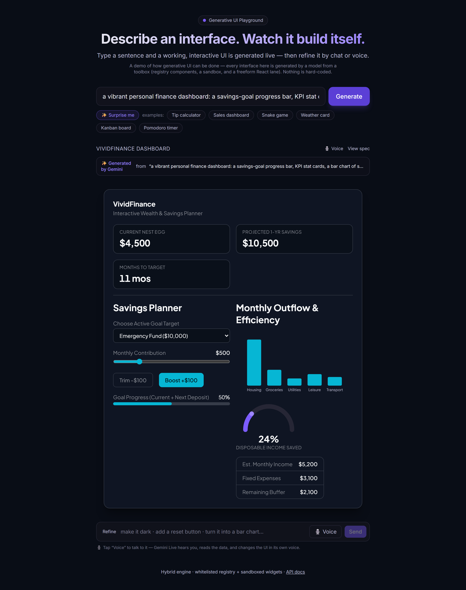

# GenUI Playground

[](https://github.com/jmurray10/generative-ai-ui/actions/workflows/ci.yml)
[](LICENSE)
[](#run-it)
[](#run-it)
[](https://ai.google.dev/)

A public playground that shows off **generative UI**: type a sentence, and a
working, interactive interface builds itself. No upload, no domain setup, no
account. **Nothing is hard-coded** — the gallery is just example *prompts*, and
every UI is generated by the model from a toolbox of components, a sandbox, and a
freeform React lane. (Generation needs a model key; without one the app loads but
shows a "connect a model" notice.)

> **This is a demo of *how* generative UI can be done** — reflected in both these docs
> and the frontend. It illustrates the hybrid approach; it is not a production product.

> A complete working demo of the hybrid approach end-to-end — registry + sandbox +
> freeform React lanes, live Gemini voice, generative theming, and multi-screen
> generation. See [status](#status--roadmap).



> _Type a sentence → a working, themed, interactive UI streams in node-by-node. Talk to it
> with the Gemini Live voice agent to read or edit the screen._

## How it works

```
prompt ─▶ /api/stream (SSE) ─▶ UISpec (JSON) ─▶ client engine ─▶ live React
   │                              │
   │   ┌──────────────────────────┴──────────────────────────────┐
   │   │ Lane A — whitelisted component registry + reactive state │
   │   │          (expr-eval bindings, no eval) + optional theme  │
   │   │ Lane B — CustomWidget: vanilla HTML/JS in a sandboxed     │
   │   │          <iframe sandbox="allow-scripts">                │
   │   │ Lane C — ReactArtifact: freeform React+Tailwind (+ npm    │
   │   │          imports, live fetch) in a sandboxed iframe       │
   │   └──────────────────────────────────────────────────────────┘
   └─▶ /voice (WebSocket) ─▶ Gemini Live voice agent (reads + edits the UI)
```

A model turns a sentence into a **UISpec** (`src/shared/spec.ts`); the client renders it
across a three-lane **toolbox** the model chooses from per node:

- **Lane A — registry** (`src/client/engine/components.tsx`): the model composes
  audited React components and fills props — it never authors code here. Dynamic
  values come from a reactive state map (`state.ts`) whose `bind` expressions run
  in a **safe parser** (`expr-eval`, no `eval`). A spec may carry an optional
  **theme** (palette + Google Font); a deterministic contrast pass flips illegible
  text and derives a legible muted tone so any palette stays readable.
- **Lane B — CustomWidget**: arbitrary HTML/JS in an isolated
  `sandbox="allow-scripts"` iframe (no same-origin) — canvas visuals, games.
- **Lane C — ReactArtifact**: freeform React+Tailwind transpiled and run in a
  sandboxed iframe, with `import` of real npm packages (recharts, three, framer-
  motion, dnd-kit, …) and `fetch()` of public CORS APIs for live data.

Beyond per-node generation: **multi-screen** prompts (deck/onboarding/wizard) are
planned→expanded into a tabbed app (each screen generated independently), and a
**Gemini Live voice agent** at `/voice` can read the on-screen data aloud and edit
the UI by speech.

## Run it

```bash
npm install
npm run dev          # client on :5173 (proxies API to the server on :8080)
```

Production-style (single server serves API + built client):

```bash
npm run build
npm start            # http://localhost:8080
```

### Docker

```bash
docker compose up --build      # http://localhost:8080
```

## API

Swagger UI at **`/docs`** (raw spec at `/openapi.json`).

| Method | Path             | Description                                          |
| ------ | ---------------- | --------------------------------------------------- |
| GET    | `/api/health`    | Liveness + active generator                         |
| GET    | `/api/examples`  | Example *prompts* for the gallery (no canned specs) |
| POST   | `/api/generate`  | `{ prompt }` → `{ spec }` (one-shot JSON)           |
| POST   | `/api/stream`    | `{ prompt, spec? }` → SSE build-in (generate/refine/multi-screen)|
| WS     | `/voice`         | Gemini Live voice agent (reads + edits the live UI) |

## Configuration

Copy `.env.example` to `.env`. With no key the app loads in `GENERATOR=stub` mode
(no generation — it shows a "connect a model" notice). Set `GENERATOR=gemini` +
`GEMINI_API_KEY` (or `GOOGLE_API_KEY`) to enable live generation **and** the voice
agent. Optional: `GEMINI_MODEL` (default `gemini-3.5-flash`), `STREAM_STAGGER_MS`.

## Status / roadmap

- **Engine & safety:** reactive state + safe `expr-eval` bindings, server-side
  `validateSpec`, Swagger, Docker.
- **Live generation:** Gemini via `@google/genai` (`gemini-3.5-flash`) behind a
  `Generator` interface, synced system prompt, robust balanced-brace JSON extraction.
- **Three-lane toolbox (~28 registry components + CustomWidget + ReactArtifact):**
  layout/display/charts/inputs; ReactArtifact runs npm imports (recharts, three,
  framer-motion, dnd-kit, …) and can `fetch()` public CORS APIs for live data.
- **Streaming & refine:** SSE `/api/stream` reveals the UI node-by-node; a chat
  refine bar edits the live spec.
- **Multi-screen:** deck/onboarding/wizard prompts are planned→expanded into a
  tabbed app (per-screen generation, state namespaced to avoid collisions).
- **Generative theming:** the model emits an optional `theme` (palette + Google
  Font); a deterministic WCAG contrast pass keeps every palette legible.
- **Voice (Gemini Live):** a `/voice` WebSocket agent with `read_ui` / `refine_ui`
  / `generate_ui` tools — live read-back round-trip, session resumption/reconnect,
  and sandbox text digests so it can "see" inside artifacts.
- **Verified:** Playwright + Chrome E2E against the Docker container — live 5/5,
  feature + theme render checks, and a Gemini Live voice agent test.

**Next:** shareable permalinks + remix.

## Project layout

```
generative-ai-ui/
├── docker-compose.yml          single container, API + built client on :8080
├── .github/workflows/ci.yml    typecheck + build on every push / PR
├── docs/                       README assets (demo screenshot)
├── src/
│   ├── shared/spec.ts          the UISpec contract (server ⇄ client)
│   ├── server/                 Express + tsx, single port 8080
│   │   ├── index.ts            routes: /api/stream (SSE), /api/generate, /docs
│   │   ├── generator.ts        Generator interface; Gemini (generate/refine/generateApp)
│   │   ├── prompt.ts           system prompt — pins the component vocabulary
│   │   ├── voice.ts            Gemini Live voice agent (/voice WebSocket)
│   │   ├── validate.ts         server-side validateSpec
│   │   └── openapi.ts          Swagger spec
│   └── client/
│       ├── App.tsx             prompt bar, gallery, refine, voice toggle
│       ├── engine/             the renderer
│       │   ├── components.tsx  Lane A registry + Lanes B/C sandbox iframes
│       │   ├── state.ts        reactive state + safe expr-eval bindings
│       │   └── GeneratedApp.tsx spec → tree, generative theming + contrast pass
│       └── voice/              VoicePanel + useLiveVoice (Live API client)
└── scripts/                    Playwright/Chrome E2E, theme, feature, voice checks
```

## Contributing

Issues and PRs welcome — see [`CONTRIBUTING.md`](./CONTRIBUTING.md). Report security issues
privately via [`SECURITY.md`](./SECURITY.md). Participation is under the
[Code of Conduct](./CODE_OF_CONDUCT.md). Notable changes are tracked in
[`CHANGELOG.md`](./CHANGELOG.md); how the models are used is in [`LLM.md`](./LLM.md).

## License

MIT — see [`LICENSE`](./LICENSE).

## Contact

Built by **Jeff Murray** ([@jmurray10](https://github.com/jmurray10)).

- Email: **jeff.murray@alumni.upenn.edu**
- LinkedIn: [linkedin.com/in/jeff-murray-ai](https://www.linkedin.com/in/jeff-murray-ai)
- GitHub: [@jmurray10](https://github.com/jmurray10)
