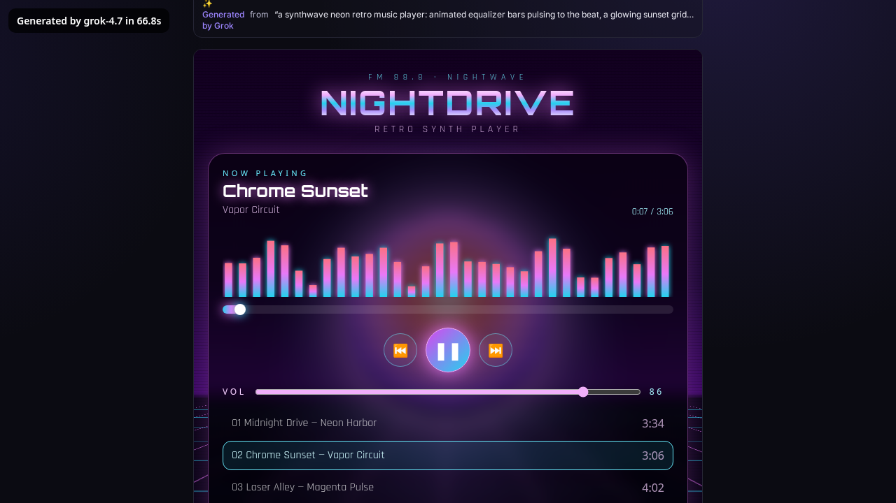
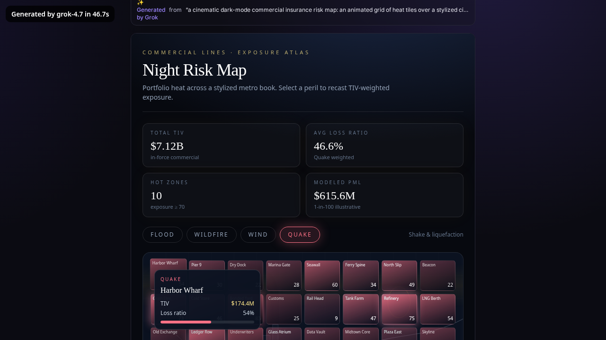
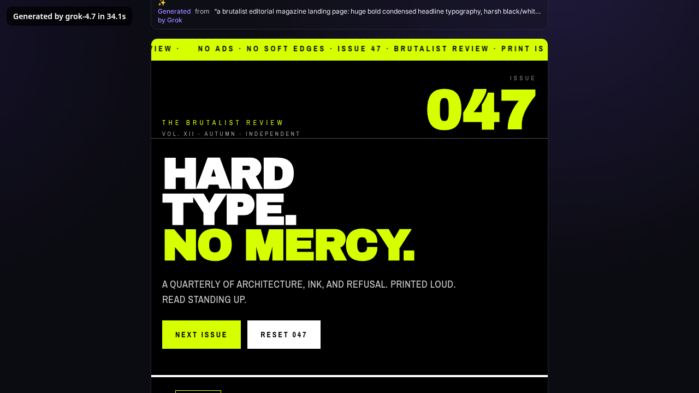
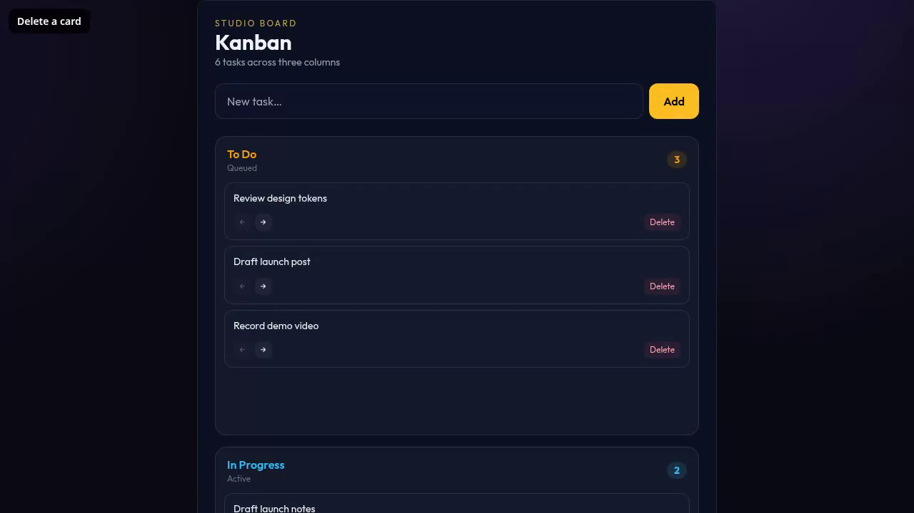
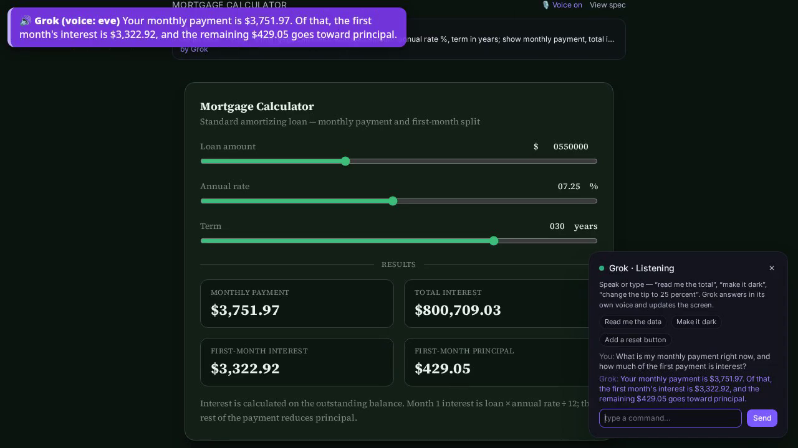
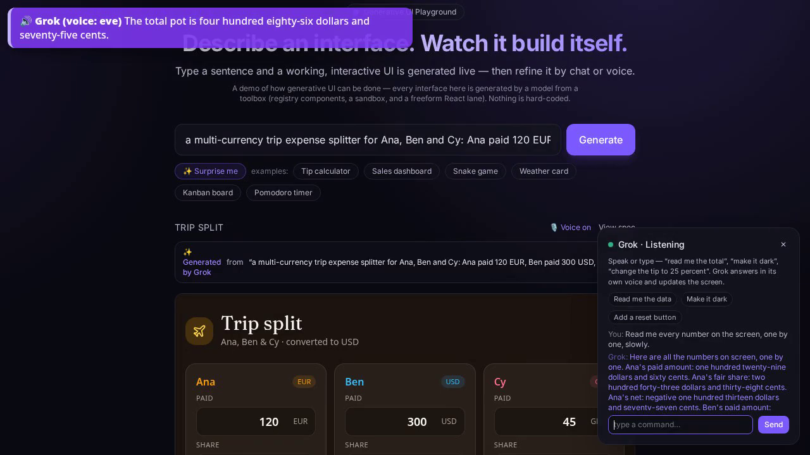

# GenUI Playground

[](https://github.com/jmurray10/generative-ai-ui/actions/workflows/ci.yml)
[](LICENSE)
[](#run-it)
[](#run-it)
[](https://docs.x.ai/)

A public playground that shows off **generative UI**: type a sentence, and a
working, interactive interface builds itself. No upload, no domain setup, no
account. **Nothing is hard-coded** — the gallery is just example *prompts*, and
every UI is generated by the model from a toolbox of components, a sandbox, and a
freeform React lane. (Generation needs a model key; without one the app loads but
shows a "connect a model" notice.)

> **This is a demo of *how* generative UI can be done** — reflected in both these docs
> and the frontend. It illustrates the hybrid approach; it is not a production product.

> A complete working demo of the hybrid approach end-to-end — registry + sandbox +
> freeform React lanes, live Grok voice, generative theming, and multi-screen
> generation. See [status](#status--roadmap).


> _Type a sentence → a working, themed, interactive UI streams in node-by-node. Talk to it
> with Grok speech-to-speech to read or edit the screen._

## Demos

Unedited screen recordings of live runs against the real xAI API: `grok-4.7`
generates every interface, and voice runs over Grok's realtime speech-to-speech
API (`grok-voice-latest`). Click a still to play the clip.

<table>
<tr>
<td width="50%"><a href="docs/media/synthwave-player.mp4"></a><br><sub><b>Synthwave player</b>: pulsing equalizer bars, a neon sunset grid, and working play, scrub and volume controls.</sub></td>
<td width="50%"><a href="docs/media/insurance-risk-map.mp4"></a><br><sub><b>Insurance risk map</b>: pulsing heat tiles, a peril switcher and hover tooltips with insured value and loss ratio.</sub></td>
</tr>
<tr>
<td><a href="docs/media/brutalist-magazine.mp4"></a><br><sub><b>Brutalist magazine</b>: oversized type, a scrolling ticker and article cards that invert on hover.</sub></td>
<td><a href="docs/media/kanban-board.mp4"></a><br><sub><b>Kanban board</b>: add, move and delete cards in a freeform React artifact.</sub></td>
</tr>
<tr>
<td><a href="docs/media/voice-mortgage.mp4"></a><br><sub><b>Voice reads live state</b>: after the inputs change to $550,000 at 7.25%, Grok answers $3,751.97 a month, $3,322.92 of it interest.</sub></td>
<td><a href="docs/media/voice-barge-in.mp4"></a><br><sub><b>Barge-in</b>: interrupted mid-readout, Grok stops and gives just the total ($486.75).</sub></td>
</tr>
</table>

In the voice clips the question is a pre-recorded prompt in xAI's `leo` voice, fed
in as the microphone, and Grok answers in the app's `eve` voice. Captions mark who
is speaking.

## How it works

```
prompt ─▶ /api/stream (SSE) ─▶ UISpec (JSON) ─▶ client engine ─▶ live React
   │                              │
   │   ┌──────────────────────────┴──────────────────────────────┐
   │   │ Lane A — whitelisted component registry + reactive state │
   │   │          (expr-eval-fork bindings, no eval) + optional theme  │
   │   │ Lane B — CustomWidget: vanilla HTML/JS in a sandboxed     │
   │   │          <iframe sandbox="allow-scripts">                │
   │   │ Lane C — ReactArtifact: freeform React+Tailwind (+ npm    │
   │   │          imports, live fetch) in a sandboxed iframe       │
   │   └──────────────────────────────────────────────────────────┘
   └─▶ /voice (WebSocket) ─▶ Grok speech-to-speech (reads + edits the UI)
```

A model turns a sentence into a **UISpec** (`src/shared/spec.ts`); the client renders it
across a three-lane **toolbox** the model chooses from per node:

- **Lane A — registry** (`src/client/engine/components.tsx`): the model composes
  audited React components and fills props — it never authors code here. Dynamic
  values come from a reactive state map (`state.ts`) whose `bind` expressions run
  in a **safe parser** (`expr-eval-fork`, no `eval`). A spec may carry an optional
  **theme** (palette + Google Font); a deterministic contrast pass flips illegible
  text and derives a legible muted tone so any palette stays readable.
- **Lane B — CustomWidget**: arbitrary HTML/JS in an isolated
  `sandbox="allow-scripts"` iframe (no same-origin) — canvas visuals, games.
- **Lane C — ReactArtifact**: freeform React+Tailwind transpiled and run in a
  sandboxed iframe, with `import` of real npm packages (recharts, three, framer-
  motion, dnd-kit, …) and `fetch()` of public CORS APIs for live data.

Beyond per-node generation: **multi-screen** prompts (deck/onboarding/wizard) are
planned→expanded into a tabbed app (each screen generated independently), and a
**Grok speech-to-speech agent** at `/voice` can read the on-screen data aloud and edit
the UI by speech. Gemini Live stays available with `VOICE_PROVIDER=gemini`.

## Design showcases

Four pages under `/showcases/*` show the design tooling working together. All the
data in them is synthetic.

| Page | What it shows |
| --- | --- |
| `/showcases/critique` (A) | **Self-critiquing generator.** Round 0 is a vague prompt with no DESIGN.md. Then up to 3 rounds of `npx impeccable@4.8.0 detect` against the rendered artifact, each followed by a Grok fix that follows the chosen DESIGN.md. Every round logs its real finding count and a screenshot, and voice can read the round summary. Nothing is planted. |
| `/showcases/design-systems` (B) | **One prompt, three design systems.** `design/{editorial-serif,ops-console,soft-consumer}/` each hold a `DESIGN.md` and a `tokens.css`. Registry components read `--gp-*` tokens only. You can switch systems live (keys 1-3), compare "swap only the token file" with a regenerate, and the DESIGN.md is sent in the system prompt on both the registry and ReactArtifact paths. |
| `/showcases/workbench` (C) | **Review workbench.** A queue, a document viewer that highlights cited lines, and an AI answer panel whose citations link to page and line. Every citation is checked against the source text. Unsupported answers show "Couldn't verify". Demo toggles cover empty, loading, error and couldn't-verify. Keys: j/k for the queue, / to ask, [ ] for citations. axe-core is a gate. |
| `/showcases/intake` (D) | **Intake wizard.** Grok extracts fields with confidence flags, and each quote is checked against the source. You fix the gaps, review a provisional result (standard or enhanced review), then approve it (with a confirmation checkbox) or send it back (a note is required). State and the audit trail carry across steps. |

### Decision layer: `decideToolbox(prompt) -> Decision`

Each page first asks one typed seam (`src/server/toolbox.ts`, `POST /api/decide`)
which design system, render path, components and checks to use. The answer is
`route`, `ask` (one fixed question) or `hold` (with a reason). A "Why these tools"
panel shows the decision and its source, and voice can read it.

- **Jev (TypeSafe)** is used when `TYPESAFE_API_KEY` is set. It sends a raw
  `POST /v1/systemone` with the same shapes as `@typesafe-ai/sdk`. The SDK
  (0.7.0) needs Node 22 and this repo runs on Node 20, so it isn't a dependency.
  Jev only answers the questions in `src/server/jev/router.questions.ts`. The
  routing policy and thresholds are code (`src/server/jev/policy.ts`).
- **Grok fallback** is used when there's no key. Grok answers the same questions
  with self-reported probabilities, and the panel labels them that way.
- **Fails closed:** if a configured Jev call errors, the result is
  `hold jev_error`. It never quietly falls back to Grok. Injection and
  contradictory prompts hold too. Only a `low_confidence` hold can be overridden
  by hand ("Build anyway (my call)").
- **Tested live against Jev** (`jev-1.13.0`, 2026-10-30) on six golden prompts:
  - Safety holds (injection, contradictory) and the vague-prompt ask behave as
    expected, at about 115-560 ms per decision.
  - With the current thresholds, Jev routes none of the three well-specified
    prompts on the first try. The workbench prompt asks for an audience (design
    pick 0.57) and routes after one answer. The wizard prompt holds
    low_confidence (render pick 0.56). See "Status".

Config: `TOOLBOX_DECIDER=auto|jev|grok` (default `auto`: Jev if a key is set,
otherwise Grok), `TYPESAFE_API_KEY`, `TYPESAFE_BASE_URL`,
`TYPESAFE_DEFAULT_MODEL` (default pinned `jev-1.13.0`) and `TYPESAFE_TIMEOUT_MS`
(default 4000).

Live gate: start the server, then run `BASE_URL=http://localhost:8080 npm run
showcases:live -- a b c d decide`. It calls real Grok (and Jev, if configured),
runs axe-core on every workbench and wizard state, and writes
`scripts/screens/showcases-live.json`.

Honest notes:
- C and D are hand-built templates. Their AI parts (answers, extraction,
  citation checks) and the decision are live, but the render-path choice only
  changes the output on A and B.
- A needs `npx` network access to fetch `impeccable@4.8.0`, or set
  `IMPECCABLE_BIN`.

## Run it

```bash
npm install
npm run dev          # client on :5173 (proxies API to the server on :8080)
```

Production-style (single server serves API + built client):

```bash
npm run build
npm start            # http://localhost:8080
```

### Docker

```bash
docker compose up --build      # http://localhost:8080
```

## API

Swagger UI at **`/docs`** (raw spec at `/openapi.json`).

| Method | Path             | Description                                          |
| ------ | ---------------- | --------------------------------------------------- |
| GET    | `/api/health`    | Liveness + active generator                         |
| GET    | `/api/examples`  | Example *prompts* for the gallery (no canned specs) |
| POST   | `/api/generate`  | `{ prompt }` → `{ spec }` (one-shot JSON)           |
| POST   | `/api/stream`    | `{ prompt, spec? }` → SSE build-in (generate/refine/multi-screen)|
| POST   | `/api/decide`    | `{ prompt, answers? }` → decision envelope (route/ask/hold + why) |
| GET    | `/api/design-systems` | The three design systems (id, name, DESIGN.md) |
| POST   | `/api/showcase/critique` | SSE detect → fix loop (A) |
| GET/POST | `/api/showcase/workbench/*`, `/api/showcase/intake/*` | Synthetic docs, cited answers, field extraction (C, D) |
| WS     | `/voice`         | Grok speech-to-speech (reads + edits the live UI)   |

## Configuration

Copy `.env.example` to `.env`. With no key the app loads and shows a "connect a
model" notice — there are no pre-baked UIs. The default provider is **Grok**:

```bash
GENERATOR=grok          # default; "stub" stays offline, "gemini" is opt-in
XAI_API_KEY=...         # required for live generation and Grok voice
GROK_MODEL=grok-4.7     # Responses API flagship (Oct 2026)
GROK_VOICE_MODEL=grok-voice-latest   # speech-to-speech alias (routes to grok-voice-think-fast-2.0)
```

`VOICE_PROVIDER=gemini` plus `GEMINI_API_KEY` keeps the previous Gemini Live
agent. Optional: `XAI_BASE_URL`, `GROK_REASONING_EFFORT` (default `low`),
`GROK_VOICE` (default `eve`), `STREAM_STAGGER_MS`, `RATE_LIMIT_PER_MIN`.

## Status / roadmap

- **Engine & safety:** reactive state + safe `expr-eval-fork` bindings, server-side
  `validateSpec`, Swagger, Docker.
- **Live generation:** Grok via the OpenAI SDK pointed at `https://api.x.ai/v1`
  (`grok-4.7`, Responses API, JSON schema). Gemini stays behind `GENERATOR=gemini`.
- **Three-lane toolbox (~28 registry components + CustomWidget + ReactArtifact):**
  layout/display/charts/inputs; ReactArtifact runs npm imports (recharts, three,
  framer-motion, dnd-kit, …) and can `fetch()` public CORS APIs for live data.
- **Streaming & refine:** SSE `/api/stream` reveals the UI node-by-node; a chat
  refine bar edits the live spec.
- **Multi-screen:** deck/onboarding/wizard prompts are planned→expanded into a
  tabbed app (per-screen generation, state namespaced to avoid collisions).
- **Generative theming:** the model emits an optional `theme` (palette + Google
  Font); a deterministic WCAG contrast pass keeps every palette legible.
- **Voice (Grok speech-to-speech):** `/voice` bridges the browser to
  `wss://api.x.ai/v1/realtime` (`grok-voice-latest`) with the same `read_ui` /
  `refine_ui` / `generate_ui` tools. Input is 16 kHz PCM, output is 24 kHz PCM.
  Gemini Live, including its session-resumption handle, stays on
  `VOICE_PROVIDER=gemini` — the current Grok speech-to-speech docs do not describe
  that handle, so a dropped Grok socket opens a fresh session.
- **Checks:** `npm test` covers spec parsing, the provider switch, the voice event
  map, and the expression sandbox. A live Grok browser run is `node scripts/live-grok.mjs`
  and needs `XAI_API_KEY` (not part of CI).
- **Design showcases / decision layer:** Jev was tested live on 2026-10-30. Safety
  holds and asks match the golden prompts. The thresholds in
  `router.questions.ts` aren't tuned yet: Jev's design and render picks for
  clear prompts land around 0.55-0.75 against a 0.70 gate, so it asks or holds
  more than it routes. The Grok fallback takes 7-17 s per decision; Jev takes
  about 0.1-0.6 s. If the same question gets an answer that doesn't raise the
  design pick, the policy asks it again.

**Next:** shareable permalinks + remix; tune the Jev thresholds on a labelled prompt set.

## Project layout

```
generative-ai-ui/
├── docker-compose.yml          single container, API + built client on :8080
├── .github/workflows/ci.yml    typecheck + build on every push / PR
├── docs/                       README assets (demo screenshot)
├── src/
│   ├── shared/spec.ts          the UISpec contract (server ⇄ client)
│   ├── server/                 Express + tsx, single port 8080
│   │   ├── index.ts            routes: /api/stream (SSE), /api/generate, /docs
│   │   ├── generator.ts        Generator interface; Grok default, Gemini opt-in, stub
│   │   ├── prompt.ts           system prompt — pins the component vocabulary
│   │   ├── voice.ts            /voice switch: Grok speech-to-speech or Gemini Live
│   │   ├── validate.ts         server-side validateSpec
│   │   └── openapi.ts          Swagger spec
│   └── client/
│       ├── App.tsx             prompt bar, gallery, refine, voice toggle
│       ├── engine/             the renderer
│       │   ├── components.tsx  Lane A registry + Lanes B/C sandbox iframes
│       │   ├── state.ts        reactive state + safe expr-eval-fork bindings
│       │   └── GeneratedApp.tsx spec → tree, generative theming + contrast pass
│       └── voice/              VoicePanel + useLiveVoice (Grok or Gemini)
└── scripts/                    Playwright/Chrome E2E, theme, feature, voice checks
```

## Contributing

Issues and PRs welcome — see [`CONTRIBUTING.md`](./CONTRIBUTING.md). Report security issues
privately via [`SECURITY.md`](./SECURITY.md). Participation is under the
[Code of Conduct](./CODE_OF_CONDUCT.md). Notable changes are tracked in
[`CHANGELOG.md`](./CHANGELOG.md); how the models are used is in [`LLM.md`](./LLM.md).

## License

MIT — see [`LICENSE`](./LICENSE).

## Contact

Built by **Jeff Murray** ([@jmurray10](https://github.com/jmurray10)).

- Email: **jeff.murray@alumni.upenn.edu**
- LinkedIn: [linkedin.com/in/jeff-murray-ai](https://www.linkedin.com/in/jeff-murray-ai)
- GitHub: [@jmurray10](https://github.com/jmurray10)
